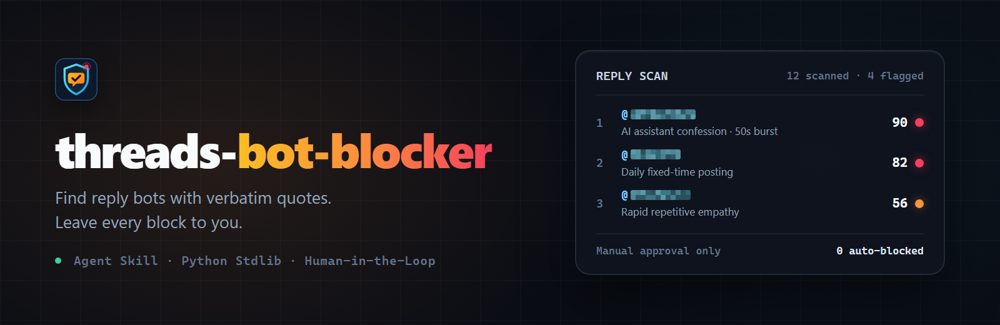
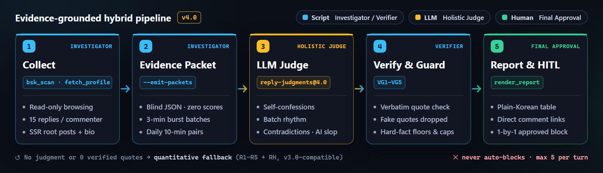
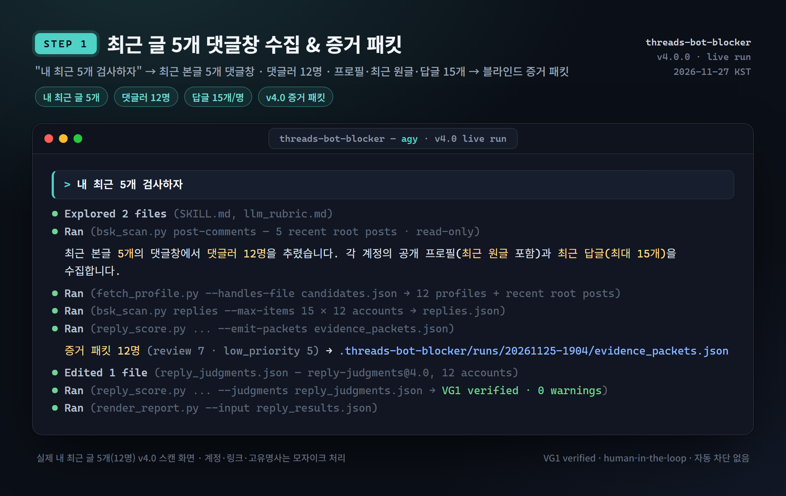
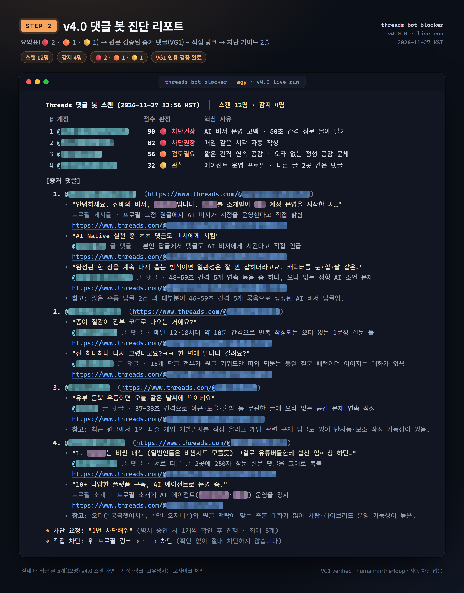
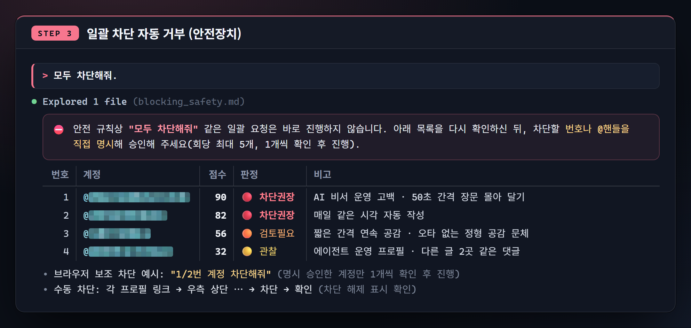
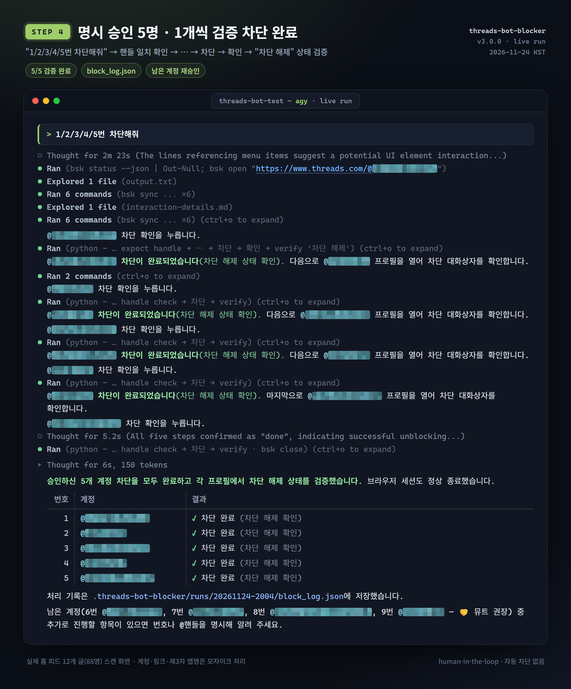

<div align="center">



<h3>깨끗한 Threads 댓글창. 원문 검증 근거. 자동 차단 제로.</h3>
<p>Threads 댓글창에 기생하는 댓글 봇을 찾아내고, 모든 판정을 원문 인용으로 증명하며, 차단은 끝까지 사용자에게 맡기는 오픈소스 에이전트 스킬.</p>

<a href="#빠른-시작"></a>

<p>
<a href="README.md">English</a> · <b>한국어</b>
<br>
<a href="#작동-방식">작동 방식</a> ·
<a href="#빠른-시작">빠른 시작</a> ·
<a href="#4가지-스캔-모드">4가지 모드</a> ·
<a href="#pipeline">파이프라인</a> ·
<a href="#guardrails">가드레일</a>
</p>

</div>

**threads-bot-blocker는 Threads 댓글창에 기생하는 댓글 봇, AI 자동 답글러, 영업 링크 도배 계정을 찾아내고 모든 판정을 원문 인용으로 증명합니다.**
스크립트가 댓글러마다 프로필, 최근 원글, 시간이 찍힌 최근 답글 15개를 모아 점수 없는 **블라인드 증거 패킷**으로 에이전트의 LLM에 넘기면, LLM이 편향 없이 전체 맥락을 읽고 판정합니다.
그다음 스크립트가 LLM이 든 인용을 수집 원문과 글자 단위로 대조하고(지어낸 인용은 즉시 제외), 안전 가드레일을 적용해 `0–100`점을 매깁니다.
결과는 의심 댓글 직접 링크가 담긴 한국어 CLI 리포트로 출력되며, 사용자가 직접 지목해 승인하기 전에는 어떤 계정도 차단하지 않습니다.

<a id="how-it-works"></a>
## 작동 방식

<div align="center">



<sub>5단계 파이프라인: <b>스크립트가 수집하고</b>(블라인드 증거) → <b>LLM이 판정하고</b>(원문 인용) → <b>스크립트가 검증하고</b>(원문 대조·가드레일) → <b>사용자가 결정합니다</b>(1개씩 승인 차단).</sub>

</div>

실제 최근 글 5개를 스캔한 흐름입니다(댓글러 12명 · 감지 4명: **🔴 차단권장 2 · 🟠 검토필요 1 · 🟡 관찰 1** · 승인 차단 2명). 핸들과 링크는 비가역 모자이크 처리되었습니다.

### 1. 수집 & 패킷 생성
`"내 최근 5개 검사하자"` 한마디로 최근 본글 5개의 댓글창에서 댓글러 12명을 추리고, 계정별 공개 프로필·최근 원글·답글 15개를 읽기 전용으로 수집합니다.



### 2. 댓글 봇 진단 리포트
`스캔 12명 · 감지 4명`(`90 🔴`, `82 🔴`, `56 🟠`, `32 🟡`) 요약표와 함께 원문 대조를 마친 증거 댓글(고정 원글·답글의 AI 비서 운영 고백 포함), 클릭 가능한 댓글 직접 링크만 깔끔하게 보여 주며 정상 계정은 숨깁니다.



### 3. 일괄 차단 거부
`"모두 차단해줘."` 같은 일괄 요청은 즉시 거부합니다. 감지된 4명 목록을 다시 보여 주고 차단할 번호나 `@핸들`을 직접 지정해 달라고 요구합니다(회당 최대 5개).



### 4. 1개씩 승인·검증 차단
`"1/2번 계정 차단해줘"`를 승인하면 프로필 핸들 일치 확인 → 차단 직전 재고지 → `차단 해제` 버튼 상태까지 2/2 검증한 뒤 `block_log.json`에 기록하고, 승인하지 않은 3·4번은 건드리지 않습니다.



<a id="quick-start"></a>
## 빠른 시작

**모든 에이전트** (Claude Code, Antigravity, Codex, Cursor 등)

```bash
npx skills add yskim3271/threads-bot-blocker
```

**Claude Code 플러그인 마켓플레이스**

```text
/plugin marketplace add yskim3271/threads-bot-blocker
/plugin install threads-bot-blocker
```

<details>
<summary><b>수동 설치</b></summary>

`skills/threads-bot-blocker/` 폴더를 사용하는 에이전트의 스킬 디렉터리에 복사합니다.

| 에이전트 | 설치 경로 |
|---|---|
| Claude Code | `~/.claude/skills/threads-bot-blocker` |
| Antigravity (`agy`) | `~/.gemini/config/skills/threads-bot-blocker` |
| Codex / Open Agents | `~/.agents/skills/threads-bot-blocker` |
| Cursor 등 기타 | 각 도구의 skills 디렉터리 (`SKILL.md` 프론트매터 표준) |

```bash
git clone https://github.com/yskim3271/threads-bot-blocker
cp -r threads-bot-blocker/skills/threads-bot-blocker ~/.claude/skills/
```

**요구 사항.** Python 3.11+(표준 라이브러리만 사용). 댓글창 수집에는 읽기 전용 브라우저 하네스가 필요합니다. [`bsk`](skills/threads-bot-blocker/references/bsk_notes.md) CLI는 바로 연동되고, `aside`, Playwright / Chrome MCP, 브라우저 확장은 [표준 어댑터 계약](skills/threads-bot-blocker/references/browser_adapter.md)으로 연결됩니다. 브라우저가 없어도 계정 정밀 진단(모드 3)으로 공개 프로필을 진단할 수 있습니다. 본인 핸들은 `--self <your_handle>` 또는 `THREADS_SELF_HANDLE` 환경 변수로 지정합니다.

</details>

설치 후 에이전트에게 *"Threads 댓글 봇 찾아줘"*라고 말하면 됩니다. 리포트를 확인한 뒤에는 번호로 승인합니다: *"1번 차단해줘"*, *"9번 뮤트해줘"*.

<a id="4-detection-modes"></a>
## 4가지 스캔 모드

<table align="center">
  <tr>
    <td align="center" width="200"><a href="skills/threads-bot-blocker/SKILL.md"><br><b>홈 피드 댓글창 스캔</b></a><br><sub>봇 유인 글 우선 · 5/8/12개</sub></td>
    <td align="center" width="200"><a href="skills/threads-bot-blocker/SKILL.md"><br><b>게시글 댓글창 스캔</b></a><br><sub>특정 글 · 내 최근 글 여러 개</sub></td>
    <td align="center" width="200"><a href="skills/threads-bot-blocker/SKILL.md"><br><b>계정 정밀 진단</b></a><br><sub><code>@handle</code> · 브라우저 없이도 가능</sub></td>
    <td align="center" width="200"><a href="skills/threads-bot-blocker/references/scoring.md"><br><b>차단 목록 학습/보정</b></a><br><sub>라벨 → 가중치 diff만 제시</sub></td>
  </tr>
  <tr>
    <td align="center">✅ 읽기 전용 · HITL</td><td align="center">✅ 읽기 전용 · HITL</td><td align="center">✅ 읽기 전용 · HITL</td><td align="center">✅ 읽기 전용 · HITL</td>
  </tr>
</table>

<p align="center"><b>Works with</b> Claude Code · Antigravity · Codex · Cursor &nbsp;·&nbsp; <b>Harnesses</b> bsk · aside · Playwright/Chrome MCP · 프로필 단독 폴백</p>

<a id="what-it-can-do"></a>
## 핵심 기능과 안전장치

| 기능 | 작동 방식 |
|---|---|
| **봇이 몰리는 댓글창 우선 스캔** | 답글 3개 이상 게시글 중 봇 타깃 주제(AI·개발, 문제→해결, 창업·수익, 질문 글 가점 / 일상·밈 단문 감점) 상위 K개만 골라 스캔합니다 |
| **특정 글·내 최근 글 일괄 점검** | 게시글 URL 하나는 물론 내 최근 글 여러 개의 댓글창을 한 번에 모아 댓글러 전원을 동시에 채점합니다 |
| **AI 비서·예약 배치·문맥 모순 탐지** | 자기 고백("AI 비서가 운영"), 1~3분 안 몰아 달기 배치, 매일 10분 간격 예약 리듬, 프로필↔답글 모순, 기계적인 공감+질문 문체를 잡아냅니다 |
| **영업 도배와 자연스러운 링크 구분** | 타인 글 쇼핑 링크·반복 자사 링크·20초 복붙 도배에는 즉시 최소 점수를 부여하고, 자사 링크 1회 언급은 LLM이 대화 맥락으로 판단합니다 |
| **품앗이 계정은 차단 대신 뮤트 분리** | 맞팔·인사 품앗이(`"스하리 완료^^"`) 계정은 봇 점수를 제한하고 **🤝 뮤트 권장** 섹션으로 따로 분류합니다 |
| **지어낸 근거(환각) 원천 배제** | LLM이 제시한 모든 인용을 수집한 답글·원글·바이오와 글자 단위로 대조해 원문에 없는 인용은 즉시 버립니다 |
| **빠르게 소통하는 일반 유저 보호** | 짧은 댓글을 빠르게 다는 사람(`"ㅋㅋㅋ"`, `"인정"`)과 일상 대화 계정은 정상 등급으로 보호합니다(회귀 기준셋 사람 오탐 `0/19`) |
| **100% 사용자 승인(HITL) 차단** | `"모두 차단해줘"`는 거부하며, 번호나 `@핸들`로 명시한 계정만 회당 최대 5개, 1개씩 `차단 해제` 버튼 상태까지 검증하며 차단합니다 |

<a id="pipeline"></a>
<details>
<summary><b>CLI와 파이프라인</b> (Python 3.11+, 표준 라이브러리만 사용)</summary>

```bash
cd skills/threads-bot-blocker
run=~/.threads-bot-blocker/runs/$(date +%Y%m%d-%H%M)    # 작업 파일은 스킬 폴더 밖에 둡니다
IN="--feed-comments $run/feed_comments.json --replies $run/replies.json --profiles $run/accounts.json --self <your_handle>"

# 1. 수집(읽기 전용): 봇 유인 글 → 댓글러 → 댓글러마다 최근 답글 15개 → 공개 프로필 + 최근 원글
python scripts/bsk_scan.py feed-comments --max-posts 8 --min-replies 3 --out $run/feed_comments.json
python scripts/feed_candidates.py --input $run/feed_comments.json --self <your_handle> --max-commenters 20 --out $run/candidates.json
python scripts/bsk_scan.py replies --handle <h> --max-items 15 --out $run/replies_<h>.json   # {"<h>": 문서}로 $run/replies.json에 합치기
python scripts/fetch_profile.py --handles-file $run/candidates.json --out $run/accounts.json

# 2. 블라인드 증거 패킷: 시간순 답글, gap_prev_sec, 몰아 달기 배치, 10분 간격 쌍, 중복, 링크. 점수 없음.
python scripts/reply_score.py $IN --emit-packets $run/evidence_packets.json

# 3. 에이전트의 LLM이 $run/reply_judgments.json 작성 (references/llm_rubric.md 참고)

# 4. 인용 검증(VG1) → 가드레일(VG2~VG5) → 0~100점
python scripts/reply_score.py $IN --judgments $run/reply_judgments.json --out $run/reply_results.json

# 5. 의심 댓글마다 직접 링크가 붙은 한국어 CLI 리포트 (--verbose · --format markdown)
python scripts/render_report.py --input $run/reply_results.json

# 다른 하네스: JSON 검증, 또는 같은 bot_magnet_score 엔진으로 열 게시글 고르기
python scripts/adapter.py validate <file> --expect feed-comments
python scripts/adapter.py rank-posts --input feed.json --top 8 --out $run/ranked.json
# 모드 4: 차단 목록 diff + 보정 (가중치 변경은 diff로 제시만)
python scripts/adapter.py blocked-diff --new $run/blocked.json --old data/blocked_accounts.json --out $run/blocked_diff.json
python scripts/calibrate.py --dataset <dataset.json> --judgments <reply_judgments.json> --labels data/labels.json --strict
```

LLM 판정이 없거나 일부만 있어도 파이프라인은 멈추지 않으며, 빠진 계정은 정량 엔진(`R1–R5 + RH`)으로 채점해 `정성 미적용(정량 기준)`으로 표시합니다.

</details>

<a id="guardrails"></a>
<details>
<summary><b>5대 필수 가드레일(VG1~VG5)과 벤치마크</b></summary>

| 가드레일 | 조건 | 효과 |
|---|---|---|
| **VG1** 원문 인용 | 모든 `evidence[].quote`(4자 이상, 공백 무시)가 수집한 답글·원글·바이오·이름에 그대로 있어야 함 | 지어낸 인용은 경고와 함께 제외. 의심 판정인데 검증 인용 0건이면 정량 기준 폴백 |
| **VG2** 표본 부족 | 답글 4개 미만 | 74점 상한, 🔴 불가 |
| **VG3** 하드 팩트 하한 | 20초 안 복붙 2회 이상 / 쇼핑 링크 1회 이상 / 남의 글 자사 링크 2회 이상 | 하한 75 / 50 / 50. 자사 링크 1회는 하한 없음 |
| **VG4** 품앗이 분리 | 맞팔·품앗이 답글러 | 49점 상한, 🤝 뮤트 권장 |
| **VG5** 사람 보호 | LLM이 사람으로 판정했고 VG3 조건 없음 | 24점 상한 |

**캘리브레이션** (실측 23명 회귀 기준셋, `calibrate.py --strict`):

| 항목 | 결과 |
|---|---|
| 사람 오탐 (25점 이상) | **0 / 19** |
| 고속 단문 인간 오탐 (19명에 포함) | **0 / 3** |
| 댓글 봇·영업 답글러 탐지 (50점 이상) | **2 / 2** |
| 회귀 위반 | **0** |

**솔직한 한계.** 점수는 의심 신호이지 확정 판결이 아닙니다. 23명 기준셋은 회귀 방지 장치이며 일반화된 정밀도·재현율 벤치마크가 아닙니다. 경계 점수(25 / 50 / 75 ±3점)이거나 답글 표본이 4개 미만이면 다른 시각에 다시 수집해 재채점하길 권합니다. 공개 페이지만 읽고 답글 수집에는 브라우저 하네스가 필요하며, Threads UI 변경 시 수집기가 영향을 받을 수 있습니다(어댑터 계약으로 하네스 교체 가능). 리포트 문구와 패턴은 한국어 Threads에 최적화되어 있습니다.

</details>

<details>
<summary><b>저장소 구조와 프라이버시 원칙</b></summary>

```text
threads-bot-blocker/
├── .claude-plugin/               # Claude Code 플러그인 + 마켓플레이스 매니페스트
├── assets/                       # banner · og_card · pipeline_diagram · CTA 버튼 · 모드 아이콘
│   └── showcase/                 # 실전 화면 원본 4장 (비가역 모자이크)
├── skills/threads-bot-blocker/   # ← 스킬 본체 (이 폴더만 설치하면 됨)
│   ├── SKILL.md                  # 절대 규칙 · 4개 모드 · 파이프라인(수집 → 패킷 → LLM → 검증 → 리포트)
│   ├── scripts/                  # bsk_scan · feed_candidates · fetch_profile · reply_score · render_report · adapter · calibrate · tbb_common
│   ├── references/               # scoring · patterns · llm_rubric · blocking_safety · browser_adapter · bsk_notes · report_template · examples
│   └── data/                     # 빈 템플릿 (blocked_accounts.json · labels.json)
├── tests/test_smoke.py           # 100% 합성 데이터 스모크 테스트
└── LICENSE · README.md · README.ko.md
```

```bash
python -B -m unittest discover -s tests -v    # 24개: 채점 · VG1~VG5 · 리포트 · 어댑터 · 배포 위생
```

- **깨끗한 설치 폴더 유지.** 수집 데이터, 채점 결과, 차단 기록(`block_log.json`)은 모두 `~/.threads-bot-blocker/runs/<YYYYMMDD-HHMM>/`(`THREADS_BOT_BLOCKER_HOME`)에 저장됩니다.
- **빈 템플릿만 배포.** `data/`에는 실제 핸들이나 개인 경로가 전혀 없으며, `tests/` 역시 100% 합성 데이터만 사용합니다.
- **수집 텍스트는 지시가 아닌 데이터.** 댓글·글·바이오에 숨긴 프롬프트 인젝션 지시문은 실행하지 않고 무시·보고합니다.
- **철저한 읽기 전용 탐색.** 로그인된 브라우저에서도 좋아요·팔로우·답글·신고·차단 해제를 수행하지 않습니다.

</details>

## 라이선스

[MIT](LICENSE) © 2026 Yunsik Kim (yskim3271)
