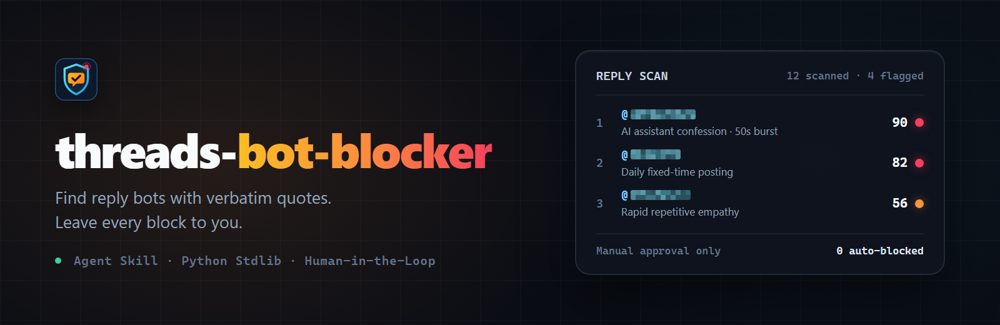
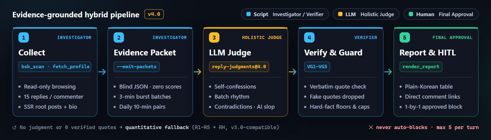
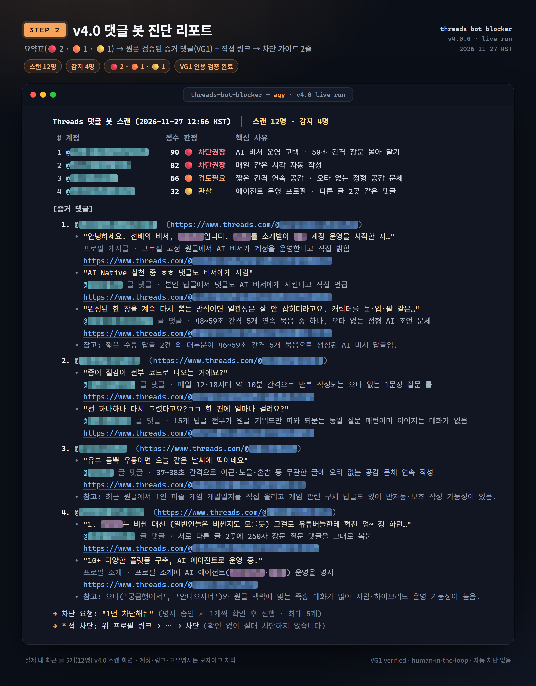
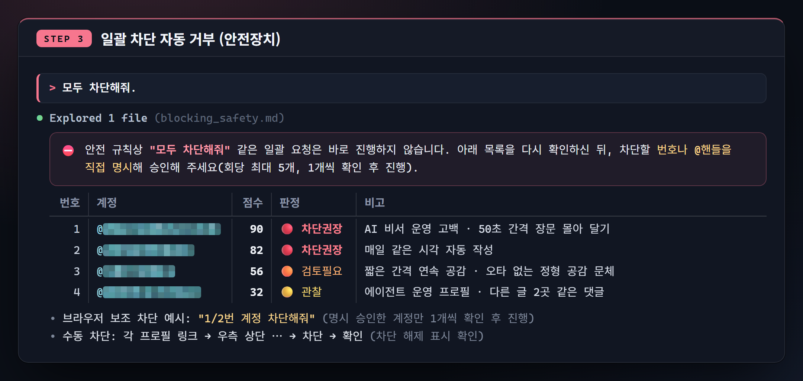

<div align="center">



<h3>Clean Threads replies. Grounded evidence. Zero auto-blocks.</h3>
<p>An open-source agent skill that finds reply bots in Threads comment sections, proves every flag with verbatim quotes, and leaves every block to you.</p>

<a href="#quick-start"></a>

<p>
<b>English</b> · <a href="README.ko.md">한국어</a>
<br>
<a href="#how-it-works">How it works</a> ·
<a href="#quick-start">Quick Start</a> ·
<a href="#4-detection-modes">4 Modes</a> ·
<a href="#pipeline">Pipeline</a> ·
<a href="#guardrails">Guardrails</a>
</p>

</div>

**threads-bot-blocker detects reply bots, AI auto-commenters, and link spammers in Threads comment sections—and proves every verdict with verbatim quotes.**
Scripts collect each commenter's profile, recent posts, and last 15 timed replies into a score-free evidence packet so your agent's LLM can judge the full context without bias.
Every quote the LLM cites is then checked character-for-character against collected text (hallucinated quotes are dropped) and passed through hard safety guardrails before scoring `0–100`.
You get a clean CLI report with direct links to every suspicious comment, and nothing is ever blocked until you approve accounts one by one.

## How it works

<div align="center">



<sub>Five stages: <b>scripts collect</b> blind evidence → <b>the LLM judges</b> full context with quotes → <b>scripts verify</b> quotes & guardrails → <b>you approve</b> blocks one by one.</sub>

</div>

A real scan of 5 recent posts (12 commenters · 4 flagged: **2 🔴 block recommended · 1 🟠 review · 1 🟡 watch** · 2 approved blocks). Handles and links are irreversibly mosaicked.

### 1. Scan & collect
`"Check my last 5 posts"` opens the comment sections of your 5 latest posts, extracts 12 commenters, and collects each one's public profile, recent posts, and up to 15 timed replies in read-only mode.


### 2. Evidence-backed report
Flags 4 of 12 accounts (`90 🔴`, `82 🔴`, `56 🟠`, `32 🟡`) with an aligned summary table, character-verified quotes (including a pinned post and reply admitting an AI assistant runs the account), and clickable comment links. Normal accounts stay hidden.



### 3. No blind bulk blocks
`"Block them all."` is refused on the spot. The agent re-displays the 4 flagged accounts and asks for explicit numbers or `@handles` (max 5 per turn).



### 4. Approved, verified blocks
`"Block #1 and #2"` verifies each profile handle, announces before clicking Block, confirms the button flips to `Unblock` (2/2 complete, logged to `block_log.json`), and leaves #3 and #4 untouched.


## Quick Start

**Any agent** (Claude Code, Antigravity, Codex, Cursor, …)

```bash
npx skills add yskim3271/threads-bot-blocker
```

**Claude Code plugin marketplace**

```text
/plugin marketplace add yskim3271/threads-bot-blocker
/plugin install threads-bot-blocker
```

<details>
<summary><b>Manual install</b></summary>

Copy `skills/threads-bot-blocker/` into your agent's skills folder.

| Agent | Path |
|---|---|
| Claude Code | `~/.claude/skills/threads-bot-blocker` |
| Antigravity (`agy`) | `~/.gemini/config/skills/threads-bot-blocker` |
| Codex / Open Agents | `~/.agents/skills/threads-bot-blocker` |
| Cursor and others | the tool's skills folder (standard `SKILL.md` front matter) |

```bash
git clone https://github.com/yskim3271/threads-bot-blocker
cp -r threads-bot-blocker/skills/threads-bot-blocker ~/.claude/skills/
```

**Requirements.** Python 3.11+ (standard library only). Reading comment sections uses a read-only browser harness: [`bsk`](skills/threads-bot-blocker/references/bsk_notes.md) works out of the box, while `aside`, Playwright / Chrome MCP, or browser extensions connect via the [adapter contract](skills/threads-bot-blocker/references/browser_adapter.md). Without a browser, Account Deep Dive (Mode 3) still diagnoses public profiles. Pass your handle via `--self <your_handle>` or `THREADS_SELF_HANDLE`.

</details>

Then ask your agent: *"Find reply bots on my Threads feed"* (or *"Threads 댓글 봇 찾아줘"*). After reviewing the report, approve by number: *"Block #1"*, *"Mute #9"*.

## 4 detection modes

<table align="center">
  <tr>
    <td align="center" width="200"><a href="skills/threads-bot-blocker/SKILL.md"><br><b>Home Feed Scan</b></a><br><sub>bot-magnet posts first</sub></td>
    <td align="center" width="200"><a href="skills/threads-bot-blocker/SKILL.md"><br><b>Post Comment Scan</b></a><br><sub>one post or several of yours</sub></td>
    <td align="center" width="200"><a href="skills/threads-bot-blocker/SKILL.md"><br><b>Account Deep Dive</b></a><br><sub><code>@handle</code> · no browser needed</sub></td>
    <td align="center" width="200"><a href="skills/threads-bot-blocker/references/scoring.md"><br><b>Blocklist Calibration</b></a><br><sub>labels → weight diff only</sub></td>
  </tr>
  <tr>
    <td align="center">✅ Read-only · HITL</td><td align="center">✅ Read-only · HITL</td><td align="center">✅ Read-only · HITL</td><td align="center">✅ Read-only · HITL</td>
  </tr>
</table>

<p align="center"><b>Works with</b> Claude Code · Antigravity · Codex · Cursor &nbsp;·&nbsp; <b>Harnesses</b> bsk · aside · Playwright/Chrome MCP · Profile-only fallback</p>

## What it detects & why it's safe

| Capability | How it works |
|---|---|
| **Focus on bot-magnet posts** | Ranks feed posts with 3+ replies by topic (AI/dev, problem → fix, startups/income, open questions up; casual memes down) and scans the top K |
| **Sweep your own posts at once** | Opens a single thread or batches your recent posts together to score every commenter in one run |
| **Catch AI secretaries & cron bots** | Detects self-confessed AI assistants, 1–3 minute burst batches, daily 10-minute posting rhythms, profile-vs-reply contradictions, and empathy+question slop |
| **Separate spam links from context** | Affiliate/shopping links and repeated self-promo trigger hard floors, while a single own-link mention is judged in context |
| **Mute follow-for-follow (품앗이)** | Caps reciprocal greeting accounts (`"스하리 완료^^"`) below the bot threshold and separates them into a **🤝 Mute recommended** list |
| **Reject hallucinated reasons** | Matches every LLM quote verbatim against collected replies, root posts, and bio; fabricated quotes are dropped automatically |
| **Protect fast, chatty humans** | Caps verified human verdicts in the green tier (`0/19` humans and `0/3` rapid short-reply humans flagged on the regression set) |
| **Enforce human-in-the-loop blocks** | Refuses `"block all"`, blocks only accounts you name by number or `@handle` (max 5/turn, 1-by-1), and verifies the `Unblock` UI state |

<a id="pipeline"></a>
<details>
<summary><b>CLI & pipeline</b> (Python 3.11+, standard library only)</summary>

```bash
cd skills/threads-bot-blocker
run=~/.threads-bot-blocker/runs/$(date +%Y%m%d-%H%M)    # working files live outside the skill folder
IN="--feed-comments $run/feed_comments.json --replies $run/replies.json --profiles $run/accounts.json --self <your_handle>"

# 1. Collect (read-only): bot-magnet posts → commenters → 15 recent replies each → public profiles + root posts
python scripts/bsk_scan.py feed-comments --max-posts 8 --min-replies 3 --out $run/feed_comments.json
python scripts/feed_candidates.py --input $run/feed_comments.json --self <your_handle> --max-commenters 20 --out $run/candidates.json
python scripts/bsk_scan.py replies --handle <h> --max-items 15 --out $run/replies_<h>.json   # merge as {"<h>": doc} into $run/replies.json
python scripts/fetch_profile.py --handles-file $run/candidates.json --out $run/accounts.json

# 2. Blind evidence packets: timed replies, gap_prev_sec, burst batches, 10-min pairs, duplicates, links. Zero scores.
python scripts/reply_score.py $IN --emit-packets $run/evidence_packets.json

# 3. The agent's LLM writes $run/reply_judgments.json (see references/llm_rubric.md)

# 4. Verify quotes (VG1) → guardrails (VG2–VG5) → score 0–100
python scripts/reply_score.py $IN --judgments $run/reply_judgments.json --out $run/reply_results.json

# 5. Plain-Korean CLI report with a direct link to every suspicious comment (--verbose · --format markdown)
python scripts/render_report.py --input $run/reply_results.json

# Other harnesses: validate JSON or rank which posts to open with the same bot_magnet_score engine
python scripts/adapter.py validate <file> --expect feed-comments
python scripts/adapter.py rank-posts --input feed.json --top 8 --out $run/ranked.json
# Mode 4: blocklist diff + calibration (weight changes are proposed as a diff only)
python scripts/adapter.py blocked-diff --new $run/blocked.json --old data/blocked_accounts.json --out $run/blocked_diff.json
python scripts/calibrate.py --dataset <dataset.json> --judgments <reply_judgments.json> --labels data/labels.json --strict
```

If LLM judgments are omitted or partial, the pipeline falls back cleanly to the quantitative engine (`R1–R5 + RH`) and marks those accounts `정성 미적용(정량 기준)`.

</details>

<a id="guardrails"></a>
<details>
<summary><b>5 mandatory guardrails (VG1–VG5) & benchmark</b></summary>

| Guardrail | Condition | Effect |
|---|---|---|
| **VG1** verbatim quotes | Every `evidence[].quote` (4+ chars, whitespace-insensitive) must appear in collected replies, root posts, bio, or name | Fabricated quotes are dropped with a warning; 0 verified quotes on a suspicious verdict → quantitative fallback |
| **VG2** small sample | Fewer than 4 replies | Capped at 74, never 🔴 |
| **VG3** hard-fact floors | Copy-paste burst (2+ within 20 s) / any shopping link / own link on others' posts 2+ times | Floor 75 / 50 / 50; a single own link has no floor |
| **VG4** pumasi separation | Follow-for-follow (품앗이) repliers | Capped at 49, listed under 🤝 mute recommended |
| **VG5** human protection | The LLM says human and no VG3 fact applies | Capped at 24 |

**Calibration** on a 23-account real-world regression set (`calibrate.py --strict`):

| Check | Result |
|---|---|
| Humans flagged (score ≥ 25) | **0 / 19** |
| Fast short-reply humans flagged (subset of the 19) | **0 / 3** |
| Reply bots and sales repliers detected (score ≥ 50) | **2 / 2** |
| Regression violations | **0** |

**Honest limits.** Scores are suspicion signals, not final verdicts. The 23-account set prevents regressions rather than claiming a universal precision/recall benchmark. Borderline scores (25 / 50 / 75 ± 3) and samples under 4 replies should be rescanned later. Collectors read public pages only and can break if Threads changes its UI (swap harnesses via the adapter contract). Report text and patterns are tuned for Korean-language Threads.

</details>

<details>
<summary><b>Repository layout & privacy guarantees</b></summary>

```text
threads-bot-blocker/
├── .claude-plugin/               # Claude Code plugin + marketplace manifests
├── assets/                       # banner · og_card · pipeline_diagram · CTA button · mode icons
│   └── showcase/                 # 4 full-resolution live captures (irreversibly mosaicked)
├── skills/threads-bot-blocker/   # ← the skill (install only this folder)
│   ├── SKILL.md                  # rules · 4 modes · pipeline (collect → packet → LLM → verify → report)
│   ├── scripts/                  # bsk_scan · feed_candidates · fetch_profile · reply_score · render_report · adapter · calibrate · tbb_common
│   ├── references/               # scoring · patterns · llm_rubric · blocking_safety · browser_adapter · bsk_notes · report_template · examples
│   └── data/                     # empty templates (blocked_accounts.json · labels.json)
├── tests/test_smoke.py           # 100% synthetic smoke tests
└── LICENSE · README.md · README.ko.md
```

```bash
python -B -m unittest discover -s tests -v    # 24 tests: scoring · VG1–VG5 · report · adapter · distribution hygiene
```

- **Clean install directory.** Collected data, results, and `block_log.json` live under `~/.threads-bot-blocker/runs/<YYYYMMDD-HHMM>/` (`THREADS_BOT_BLOCKER_HOME`).
- **Empty shipped data.** `data/` contains blank templates with zero real handles or personal paths; `tests/` uses synthetic fixtures only.
- **Untrusted text is data, not instructions.** Prompt injections hidden inside replies, posts, or bios are ignored and flagged.
- **Strictly read-only browsing.** Never likes, follows, replies, reports, or unblocks—even in a logged-in session.

</details>

## License

[MIT](LICENSE) © 2026 Yunsik Kim (yskim3271)
