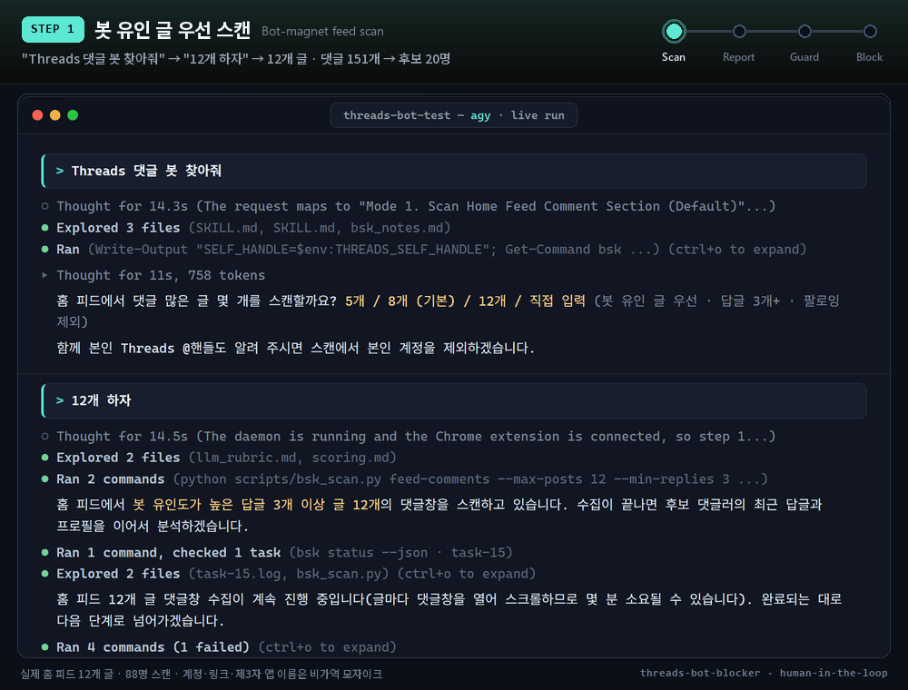
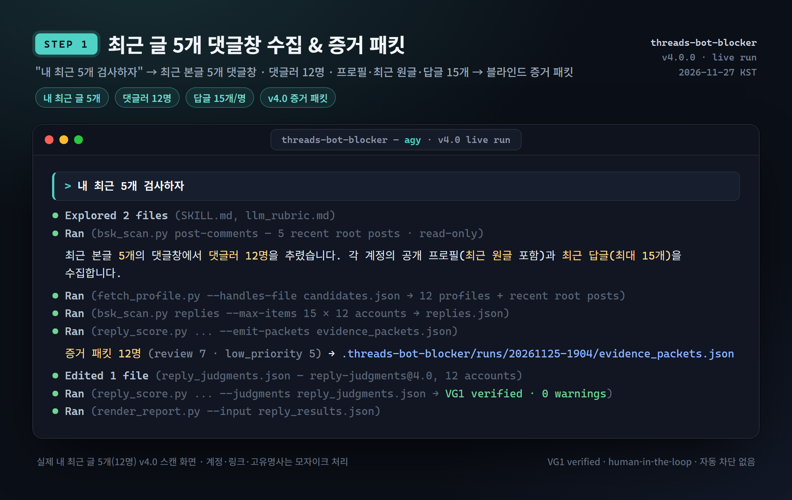
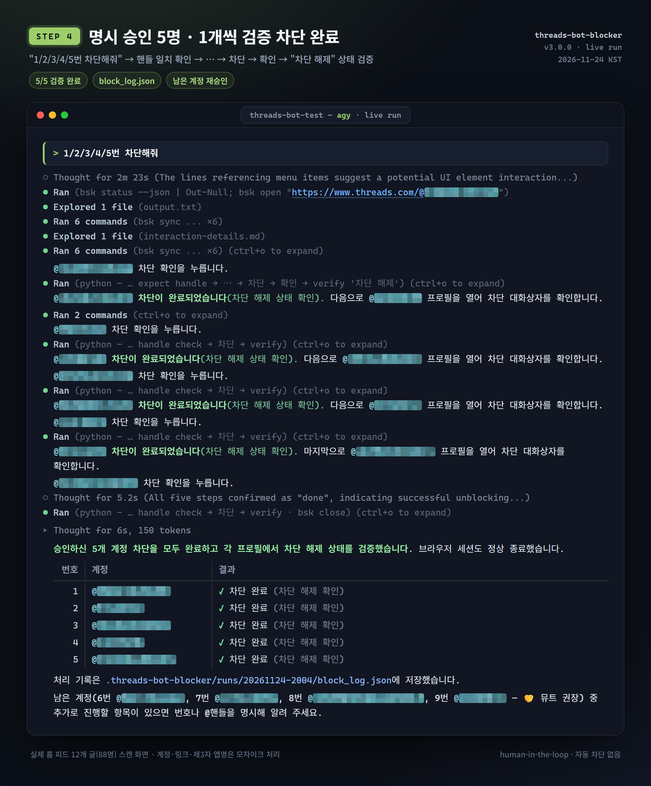

<div align="center">

<a href="#see-it-in-action"></a>

<h3>Clean Threads replies. Grounded evidence. Zero auto-blocks.</h3>
<p>An open-source agent skill that finds the reply bots living in Threads comment sections, proves every verdict with verbatim quotes, and leaves every block to you.</p>

<a href="#see-it-in-action"></a>&nbsp;
<a href="#quick-start"></a>

<p>
<b>English</b> · <a href="README.ko.md">한국어</a>
<br>
<a href="#see-it-in-action">See it in action</a> ·
<a href="#4-detection-modes">4 Modes</a> ·
<a href="#quick-start">Quick Start</a> ·
<a href="#pipeline">Pipeline</a> ·
<a href="#guardrails">Guardrails</a>
</p>

</div>

**threads-bot-blocker v4.0 is an evidence-grounded, LLM-first hybrid that tells your agent who is a reply bot and shows you exactly why.**
Scripts collect each commenter's profile, recent root posts and last 15 timed replies, then hand the agent's LLM a **blind evidence packet** with no scores in it.
The LLM judges each packet as a whole: self-confessed AI secretaries, scheduled burst batches, profile ↔ reply contradictions, empathy-plus-question slop and parasitic shopping links.
Scripts then check **every quote verbatim** against the collected text (VG1, fabricated quotes are dropped) and apply hard-fact guardrails (VG2–VG5) before scoring 0–100.
You get a plain-Korean CLI report with a direct link to every suspicious comment, and nothing is blocked until you name the account, one at a time.

## See it in action

<div align="center">



<sub>A real home-feed scan: 12 posts · 88 commenters · 9 flagged. Handles, links and third-party app names are irreversibly mosaicked (the original glyphs were never rendered).</sub>


<sub>v4.0 in five stages: <b>scripts investigate</b> (blind evidence) → <b>the LLM judges</b> (with quotes) → <b>scripts verify</b> (VG1–VG5) → <b>you decide</b> (1-by-1 approved blocks).</sub>

</div>

<details>
<summary><b>Inspect all 4 full-resolution live captures (STEP 1–4)</b></summary>

<br>

**STEP 1 · Bot-magnet feed scan.** "Find reply bots" → "Let's do 12": 12 posts, 151 comments, 20 candidates, 15 recent replies each.



**STEP 2 · Plain-Korean report.** `88 scanned · 9 flagged`: summary table, evidence quotes with direct comment links, a two-line block guide.


**STEP 3 · Bulk block refused.** "Block them all." is not executed; the list is shown again and explicit numbers or @handles are requested.


**STEP 4 · Verified 1-by-1 blocks.** "Block 1/2/3/4/5": handle match → `⋯` → Block → confirm → `Unblock` state verified, 5/5, logged to `block_log.json`.



</details>

## Quick Start

**Any agent** (Claude Code, Antigravity, Codex, Cursor, …)

```bash
npx skills add yskim3271/threads-bot-blocker
```

**Claude Code plugin marketplace**

```text
/plugin marketplace add yskim3271/threads-bot-blocker
/plugin install threads-bot-blocker
```

<details>
<summary><b>Manual install</b></summary>

Copy `skills/threads-bot-blocker/` into your agent's skills folder.

| Agent | Path |
|---|---|
| Claude Code | `~/.claude/skills/threads-bot-blocker` |
| Antigravity (`agy`) | `~/.gemini/config/skills/threads-bot-blocker` |
| Codex / Open Agents | `~/.agents/skills/threads-bot-blocker` |
| Cursor and others | the tool's skills folder (standard `SKILL.md` front matter) |

```bash
git clone https://github.com/yskim3271/threads-bot-blocker
cp -r threads-bot-blocker/skills/threads-bot-blocker ~/.claude/skills/
```

**Requirements.** Python 3.11+ only, every script uses the standard library. To read comment sections the agent needs a read-only browser harness: the [`bsk`](skills/threads-bot-blocker/references/bsk_notes.md) CLI works out of the box, and `aside`, Playwright / Chrome MCP or an extension work through the [adapter contract](skills/threads-bot-blocker/references/browser_adapter.md). Without a browser, mode 3 still diagnoses public profiles. Your own handle is never hard-coded: pass `--self <your_handle>` or set `THREADS_SELF_HANDLE`.

</details>

Then just ask: *"Find reply bots on my Threads feed."* (or in Korean, *"Threads 댓글 봇 찾아줘"*). After the report, approve by number: *"Block #1"*, *"Mute #9"*.

## 4 detection modes

<table align="center">
  <tr>
    <td align="center" width="200"><a href="skills/threads-bot-blocker/SKILL.md"><br><b>Home Feed Scan</b></a><br><sub>bot-magnet posts first</sub></td>
    <td align="center" width="200"><a href="skills/threads-bot-blocker/SKILL.md"><br><b>Post Comment Scan</b></a><br><sub>one post or several of yours</sub></td>
    <td align="center" width="200"><a href="skills/threads-bot-blocker/SKILL.md"><br><b>Account Deep Dive</b></a><br><sub><code>@handle</code> · no browser needed</sub></td>
    <td align="center" width="200"><a href="skills/threads-bot-blocker/references/scoring.md"><br><b>Blocklist Calibration</b></a><br><sub>labels → weight diff only</sub></td>
  </tr>
  <tr>
    <td align="center">✅ Read-only · HITL</td><td align="center">✅ Read-only · HITL</td><td align="center">✅ Read-only · HITL</td><td align="center">✅ Read-only · HITL</td>
  </tr>
</table>

<p align="center"><b>Works with</b> Claude Code · Antigravity · Codex · Cursor &nbsp;·&nbsp; <b>Harnesses</b> bsk · aside · Playwright/Chrome MCP · SSR fallback</p>

## What it can do

| What you want | What threads-bot-blocker gives you |
|---|---|
| Find the comment sections bots love | `bot_magnet_score` ranks posts with 3+ replies (AI and dev, problem → fix, startup and income, questions up; daily memes down) and opens the top K |
| Sweep one post, or several of your own | Mode 2 reads every comment section and scores all commenters together in one run |
| Catch AI secretaries, cron posting and contradictions | The LLM reads blind packets: self-confessions ("run by my AI assistant"), 3-minute burst batches, daily 10-minute pairs, profile ↔ reply contradictions, AI empathy slop |
| Never trust a made-up reason | VG1 matches every quote verbatim against collected replies, root posts and bio; fabricated quotes are dropped, and 0 verified quotes means a quantitative fallback |
| Leave fast, chatty humans alone | VG5 caps human verdicts at 24; the regression set flags 0 of 3 fast short-reply humans and 0 of 19 humans |
| Read a one-off own link like a person would | A single own-store link has no floor, so the LLM decides from context; shopping links, repeated own links and copy-paste bursts get hard floors (VG3) |
| Mute follow-for-follow (품앗이) instead of blocking | VG4 caps those accounts at 49 and lists them in a separate 🤝 mute-recommended section |
| Block safely | Never auto-blocks: "block them all" is refused, only accounts you name by number or `@handle`, max 5 per turn, one at a time, each verified by the `Unblock` state |

<a id="pipeline"></a>
<details>
<summary><b>CLI & v4.0 pipeline</b> (Python 3.11+, standard library only)</summary>

```bash
cd skills/threads-bot-blocker
run=~/.threads-bot-blocker/runs/$(date +%Y%m%d-%H%M)    # working files live outside the skill folder
IN="--feed-comments $run/feed_comments.json --replies $run/replies.json --profiles $run/accounts.json --self <your_handle>"

# 1. Collect (read-only): bot-magnet posts → commenters → 15 recent replies each → public SSR profiles + root posts
python scripts/bsk_scan.py feed-comments --max-posts 8 --min-replies 3 --out $run/feed_comments.json
python scripts/feed_candidates.py --input $run/feed_comments.json --self <your_handle> --max-commenters 20 --out $run/candidates.json
python scripts/bsk_scan.py replies --handle <h> --max-items 15 --out $run/replies_<h>.json   # merge as {"<h>": doc} into $run/replies.json
python scripts/fetch_profile.py --handles-file $run/candidates.json --out $run/accounts.json

# 2. Blind evidence packets: timed replies, gap_prev_sec, burst batches, 10-min pairs, duplicates, links. Zero scores.
python scripts/reply_score.py $IN --emit-packets $run/evidence_packets.json

# 3. The agent's LLM writes $run/reply_judgments.json (reply-judgments@4.0, see references/llm_rubric.md)

# 4. Verify quotes (VG1) → guardrails (VG2–VG5) → score 0–100
python scripts/reply_score.py $IN --judgments $run/reply_judgments.json --out $run/reply_results.json

# 5. Plain-Korean CLI report with a direct link to every suspicious comment (--verbose · --format markdown)
python scripts/render_report.py --input $run/reply_results.json

# Other harnesses: validate their JSON, or rank which posts to open with the same bot_magnet_score engine
python scripts/adapter.py validate <file> --expect feed-comments
python scripts/adapter.py rank-posts --input feed.json --top 8 --out $run/ranked.json
# Mode 4: blocklist diff + calibration (weight changes are proposed as a diff only)
python scripts/adapter.py blocked-diff --new $run/blocked.json --old data/blocked_accounts.json --out $run/blocked_diff.json
python scripts/calibrate.py --dataset <dataset.json> --judgments <reply_judgments.json> --labels data/labels.json --strict
```

No LLM judgment, a partial file or the v3.0 format? The run still finishes: missing accounts are scored by the quantitative engine (R1–R5 + RH) and marked `정성 미적용(정량 기준)`.

</details>

<a id="guardrails"></a>
<details>
<summary><b>5 mandatory guardrails (VG1–VG5) & benchmark</b></summary>

| Guardrail | Condition | Effect |
|---|---|---|
| **VG1** verbatim quotes | Every `evidence[].quote` (4+ chars, whitespace-insensitive) must appear in the collected replies, root posts, bio or name | Fabricated quotes are dropped with a warning; 0 verified quotes on a suspicious verdict → quantitative fallback |
| **VG2** small sample | Fewer than 4 replies | Capped at 74, never 🔴 |
| **VG3** hard-fact floors | Copy-paste burst (2+ within 20 s) / any shopping link / own link on others' posts 2+ times | Floor 75 / 50 / 50; a single own link has no floor |
| **VG4** pumasi separation | Follow-for-follow (품앗이) repliers | Capped at 49, listed under 🤝 mute recommended |
| **VG5** human protection | The LLM says human and no VG3 fact applies | Capped at 24 |

**Calibration** on a 23-account real-world regression set, `calibrate.py --strict`:

| Check | Result |
|---|---|
| Humans flagged (score ≥ 25) | **0 / 19** |
| Fast short-reply humans flagged (subset of the 19) | **0 / 3** |
| Reply bots and sales repliers detected (score ≥ 50) | **2 / 2** |
| Violations · new hits from the v4.0 batch-rhythm signal | **0 · 0** |

**Honest positioning.** Scores are suspicion signals, not verdicts. The 23-account set guards against regressions; it is not a precision or recall benchmark. Borderline scores (25 / 50 / 75 ± 3) and samples under 4 replies deserve a rescan at another time of day. The skill reads only public pages, needs a browser harness to collect replies, and its collectors can break when the Threads UI changes (the adapter contract lets you swap harnesses). Report wording and examples are tuned for Korean-language Threads.

</details>

<details>
<summary><b>v4.0 highlights</b></summary>

1. **SSR root posts**: the 3 most recent root posts (plus one older, so pinned self-introductions are not missed) join the profile and the VG1 quote corpus.
2. **Burst batches & 10-minute cron pairs**: `gap_prev_sec` per reply, 0–180 s clusters split at outlier gaps, 540–720 s repeat pairs and a `daily_schedule_hint`.
3. **Blind evidence packets** (`--emit-packets`): every commenter with 1+ reply, review-first ordering, and zero score, tier or verdict keys (checked recursively by tests).
4. **VG1 strict quote grounding**: quotes are matched by comment code, then replies, root posts, bio and name; 0 verified quotes falls back instead of guessing.
5. **Contextual one-off own links**: a single own-store mention is judged in context, while repeated own links and shopping links keep their hard floors.
6. **Graceful fallback**: v3.0 judgments (R3 / RH1 / RH2) and quant-only runs still work, with byte-identical v3.0 CLI output.

</details>

<details>
<summary><b>Repository layout & privacy guarantees</b></summary>

```text
threads-bot-blocker/
├── .claude-plugin/               # Claude Code plugin + marketplace manifests
├── assets/                       # banner · og_card · showcase_flow.gif · pipeline_diagram · CTA buttons · mode icons
│   └── showcase/                 # 4 full-resolution live captures (irreversibly mosaicked)
├── skills/threads-bot-blocker/   # ← the skill (install only this folder)
│   ├── SKILL.md                  # absolute rules · 4 modes · v4.0 pipeline (collect → packet → LLM → verify → report)
│   ├── scripts/                  # bsk_scan · feed_candidates · fetch_profile · reply_score · render_report · adapter · calibrate · tbb_common
│   ├── references/               # scoring · patterns · llm_rubric · blocking_safety · browser_adapter · bsk_notes · report_template · examples
│   └── data/                     # empty templates (blocked_accounts.json · labels.json)
├── tests/test_smoke.py           # 100% synthetic smoke tests
└── LICENSE · README.md · README.ko.md
```

```bash
python -B -m unittest discover -s tests -v    # 24 tests: scoring · VG1–VG5 · report · adapter · distribution hygiene
```

- **The install folder stays clean.** Collected data, results and the block log (`block_log.json`) go to `~/.threads-bot-blocker/` (`THREADS_BOT_BLOCKER_HOME`), one `runs/<YYYYMMDD-HHMM>/` folder per run.
- **Shipped data is empty.** `data/` holds empty templates with no real handles or personal paths, and `tests/` uses invented data only.
- **Collected text is data, not instructions.** Instructions hidden in comments, posts or bios (prompt injection) are ignored and reported.
- **Read-only browsing.** Even in a logged-in browser it never likes, follows, replies, reports or unblocks.

</details>

## License

[MIT](LICENSE) © 2026 Yunsik Kim (yskim3271)
